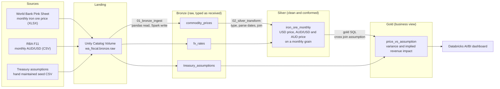

# WA Fiscal Exposure Lakehouse

A medallion lakehouse on Databricks that measures how far iron ore prices sit from the price assumption in the Western Australian state budget and what that gap is worth in state revenue.

**Status:** Phase 1 complete (source to lakehouse to dashboard). Later phases are listed in the roadmap below.

## The question

WA Treasury budgets on an assumed iron ore price and publishes a sensitivity: roughly A$93 million of state revenue for every US$1 per tonne of price movement [WA State Budget 2026-2027](https://www.ourstatebudget.wa.gov.au/2026-27/budget-papers/bp3/2026-27-wa-state-budget-bp3.pdf). This project joins public iron ore prices and AUD/USD rates to that assumption and answers one question each month:

> Is iron ore trading above or below the budget assumption, and what is the difference worth to the State?

## Architecture



### Layer summary

| Layer | Table | Purpose |
|---|---|---|
| Bronze | `commodity_prices` | Iron ore price by month, with `_ingested_at` and `_source_file` metadata |
| Bronze | `fx_rates` | AUD/USD by month, with ingestion metadata |
| Bronze | `treasury_assumptions` | Assumed price and revenue sensitivity by fiscal year |
| Silver | `iron_ore_monthly` | Monthly USD price, exchange rate and AUD price from 2015 onward |
| Gold | `price_vs_assumption` | Price variance against assumption and `implied_revenue_impact_aud_m` |

The key calculation lives in the gold layer:

```
implied_revenue_impact_aud_m = (price_usd_per_tonne - assumed_price_usd) * sensitivity_aud_m_per_usd
```

## Data sources

| Source | Content | Access |
|---|---|---|
| World Bank Commodity Markets (Pink Sheet) | Monthly iron ore price, CFR spot | worldbank.org/en/research/commodity-markets |
| Reserve Bank of Australia, table F11 | Monthly AUD/USD exchange rate | rba.gov.au/statistics/tables |
| WA State Budget papers | Iron ore price assumption and revenue sensitivity | ourstatebudget.wa.gov.au |

The Treasury assumption file is hand maintained seed data. Each row carries a `source` column naming the budget paper it came from. Check the figures against the current budget papers before relying on them.

Check the current licence terms of each source before reuse and keep the attribution each one asks for.

## Repository layout

```
.
├── README.md
├── notebooks/
│   ├── 01_bronze_ingest.py
│   └── 02_silver_transform.py
├── sql/
├── seed/
│   └── treasury_assumptions.csv
└── dashboards/
    └── wa_fiscal_dashboard.lvdash.json
```

Raw downloads from the World Bank and the RBA are not committed. Download them from the sources above and upload them to the volume.

## How to run

1. Create a Databricks Free Edition workspace.
2. Run the setup SQL:
   ```sql
   CREATE CATALOG IF NOT EXISTS wa_fiscal;
   CREATE SCHEMA IF NOT EXISTS wa_fiscal.bronze;
   CREATE SCHEMA IF NOT EXISTS wa_fiscal.silver;
   CREATE SCHEMA IF NOT EXISTS wa_fiscal.gold;
   CREATE VOLUME IF NOT EXISTS wa_fiscal.bronze.raw;
   ```
   If catalog creation is blocked, create the schemas under the default catalog and adjust the table names.
3. Download the three source files and upload them to `/Volumes/wa_fiscal/bronze/raw/`.
4. Run `01_bronze_ingest`, then `02_silver_transform`, then `03_gold_transform.ipynb`'.
5. Create a dashboard on `wa_fiscal.gold.price_vs_assumption`.

## Design decisions

- **Inspect files.** Both source files carry multi row headers and text markers for missing values. The ingest notebook makes price columns to numeric so markers become nulls before they reach Spark.
- **Add metadata on every bronze row.** `_ingested_at` and `_source_file` make lineage visible from the first layer.
- **Seed data as input.** A reference value that does not come from a feed is stored as a versioned CSV with a source citation, not hard coded in SQL.
- **Small data.** The Phase 1 dataset holds a few thousand rows. This project demonstrates modelling and governance patterns, not volume.
- **Built in phases.** Phase 1 uses simple batch ingestion on purpose. Phase 2 replaces it with Auto Loader so the gain is measurable against a working baseline.

## Roadmap

| Phase | Scope |
|---|---|
| 1 (done) | Three sources, medallion tables, one gold view and then one dashboard |
| 2 | Auto Loader ingestion, royalty receipts from the WA Statistics Digest, gold and lithium prices |
| 3 | Lakeflow Declarative Pipelines, data quality expectations, royalty concentration index |
| 4 | Unity Catalog governance and tagging, Declarative Automation Bundles, CI/CD, scenario analysis, Power BI |

## Limitations

- Phase 1 covers iron ore only. Gold, lithium and gas are not yet modelled.
- The revenue impact uses a single linear sensitivity from the budget papers. It ignores exchange rate effects on royalties and production volume changes.
- Monthly spot prices are compared with an annual budget assumption. Royalty timing and the contract price basis differ from the spot series.
- This is an illustrative analysis built on public data. It is not financial advice or an official forecast.

## Attribution

Contains data from the World Bank, the Reserve Bank of Australia and the Government of Western Australia. Extracted data from following sources
1. Treasury Assumptions - [WA State Budget](https://www.ourstatebudget.wa.gov.au/2026-27/budget-papers/bp3/2026-27-wa-state-budget-bp3.pdf)
2. Iron ore prices, [Monthly prices in World Bank Pink Sheet](https://www.worldbank.org/en/research/commodity-markets)
3. Exchange rate - [Exchange Rates – Monthly – January 2010 to latest complete month of current year](https://www.rba.gov.au/statistics/historical-data.html?v=2026-10-14-17-04-26#exchange-rates)
